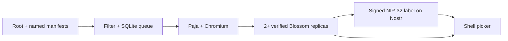

<div align="center">

# Napshot

**Missing screenshots for Nostr napplets, captured and labeled.**

[](deno.json)
[](https://github.com/napplet/napshot/stargazers)

[Quick start](#quick-start) · [Shell integration](#shell-integration) · [Configuration](#configuration) · [Operations](#operations)

</div>

Napshot watches root (`15129`) and named (`35129`) napplet manifests for missing screenshots.
It renders verified HTML in a fresh, sandboxed Paja shell, mirrors the PNG to at least two
Blossom servers, and publishes a signed NIP-32 label referencing the exact manifest event.
Shells discover these previews through Nostr without changing the author’s manifest.

- **Author media first.** Usable screenshots in the manifest take precedence; trusted labels prevent duplicate work.
- **Resumes after restart.** SQLite preserves jobs, captures, upload receipts, and signed labels through failures.
- **Verifiable delivery.** Uploaded bytes are read back and checked before their servers appear in the label.
- **One process.** The worker also serves a live capture viewer, public status, and a health endpoint.

Captures show the napplet's **first view with real data**. Napplets that declare the `identity` NAP
(a required `R`, optional `O`, or legacy `requires` tag) are shown a configured read-only preview
account (`NAPSHOT_PREVIEW_IDENTITY`); all others are signed out. Napplets that declare `relay`,
`outbox` or `identity` get read-only access to the configured relays through the shell, and the
screenshot waits until shell traffic into the napplet has gone quiet. Each label records the shell
features its capture had in a `capture` tag; when the configuration grants more, the napplet is queued
again and the superseded label is retracted with a NIP-09 deletion request. Snapshots (`5129`) are excluded.

## Quick start

Requires **Deno 2.9.6+** and **Chromium with a working sandbox**.
Deno installs dependencies and runs the TypeScript service directly; no Node.js or pnpm is required.
The default browser path is `/usr/bin/chromium`; set `NAPSHOT_CHROMIUM` for another installation.
Napshot does not download a browser or disable its sandbox.

```sh
git clone https://github.com/napplet/napshot.git
cd napshot
deno install --frozen
cp .env.example .env
chmod 600 .env
```

Edit `.env` and replace the example endpoints with your own configuration:

| Required setting | Supply |
| --- | --- |
| `NAPSHOT_SECRET_KEY` | A dedicated 64-character lowercase hex signing key |
| `NAPSHOT_RELAYS` | Comma-separated `wss://` relays to watch and publish to |
| `NAPSHOT_BLOSSOM_SERVERS` | At least two distinct HTTPS origins that accept uploads from your signer |

To generate a dedicated key locally:

```sh
deno task keygen
```

Copy the key into `.env`, keep it private, and start the service:

```sh
deno task start
```

Open **<http://127.0.0.1:3080>** for the live capture viewer and instance status. The startup log
and `/api/status` expose the public signer key that shell operators can verify and trust.

To preview the page without a signing key or a running worker:

```sh
deno task preview
```

## Shell integration

Install the coding-agent skill:

```sh
npx skills add napplet/napshot
```

The optional skills installer uses `npx`; it is separate from the Deno service.
Then ask your agent: “Use `$napshot-shell` to add trusted screenshot fallbacks to our napplet picker.”

The [skill](skills/napshot-shell/SKILL.md) covers discovery, signer trust, image verification,
and mirror fallback. Shells query kind `1985` using `#e` for the **exact manifest event ID**,
`#L: ["#screenshot"]`, and an explicitly trusted author list. Each label carries a
`screenshot` tag with the PNG hash, MIME type, dimensions, and size, plus its Blossom servers.

Prefer author-provided media, verify label signatures and downloaded bytes, and never
attach an image using only the stable `a` address. See the [wire contract](docs/protocol.md)
for complete tags and a query example. Shells read directly from Nostr and Blossom;
Napshot’s HTTP process does not need to stay online for already published previews.

### Public instance signer

The public napplet Napshot instance signs labels with this key. Pin it in your shell's
source rather than learning it from the instance at runtime:

| Field | Value |
|---|---|
| Hex | `94b92a261c88f6b14098e6ec15c93bed544380883745f9a030b27d4a5c554f81` |
| npub | `npub1jjuj5fsu3rmtzsycumkptjfma42y8qygxazlngpskf755hz4f7qspp2xx4` |
| NIP-05 | `napshot@napplet.run` |
| Label relays | `wss://relay.napplet.soy/`, `wss://relay.primal.net/` |

Two independent sources agree on the key: this repository and
<https://napplet.run/.well-known/nostr.json?name=napshot>. The instance's `/api/status`
and its self-signed profile and relay list should match them, but neither one is a trust anchor.
If the key ever rotates, it changes here and in that NIP-05 document together.

## How it works



Each label is saved before publication. If a relay acknowledgement is lost, a retry
resends the same signed event. Upload failures retain the PNG and successful replicas;
publication waits until the configured minimum is met.

## Configuration

| Variable | Meaning / default |
| --- | --- |
| `NAPSHOT_SECRET_KEY` | Required lowercase hex private key; keep stable across restarts |
| `NAPSHOT_RELAYS` | Required comma-separated `wss://` relay URLs for watching and publishing |
| `NAPSHOT_PROFILE` | Optional JSON profile; enables kind-0 and NIP-65 self-publication with the existing signer and relays |
| `NAPSHOT_BLOSSOM_SERVERS` | Required distinct HTTPS origins; at least two; also artifact fallbacks |
| `NAPSHOT_MIN_REPLICAS` | Minimum verified uploads before publication, default `2`, never below `2` |
| `NAPSHOT_TRUSTED_AUTHORS` | Additional comma-separated hex labeler public keys; own signer is always trusted |
| `NAPSHOT_DATA_DIR` | Local durable SQLite directory, default `./data` |
| `NAPSHOT_CHROMIUM` | Browser executable, default `/usr/bin/chromium` |
| `NAPSHOT_HOST`, `NAPSHOT_PORT` | Viewer/status bind, default `127.0.0.1:3080` |
| `NAPSHOT_BACKFILL_SINCE` | Oldest manifest timestamp to backfill (unix seconds), default `0` (all history); lowering it later extends the backfill |
| `NAPSHOT_CONCURRENCY` | Captures processed in parallel, each in its own browser, default `3` |
| `NAPSHOT_RESYNC_MS` | Safety-net catch-up interval behind the live relay subscriptions, default `900000` |
| `NAPSHOT_PREVIEW_IDENTITY` | Optional `npub` or hex public key shown read-only to napplets that declare the `identity` NAP (`R`, `O`, or `requires`); no signer is exposed |
| `NAPSHOT_WIDTH`, `NAPSHOT_HEIGHT` | Capture dimensions, default `1200` × `750` |
| `NAPSHOT_CAPTURE_DELAY_MS` | Minimum time the napplet runs before any screenshot, default `1500` |
| `NAPSHOT_CAPTURE_IDLE_MS` | Quiet period on the shell bus that counts as settled, default `2000` |
| `NAPSHOT_CAPTURE_SETTLE_MS` | Upper bound on waiting for the bus to settle, default `15000` |
| `NAPSHOT_RECAPTURE_BEFORE` | Unix time; on startup, previews labeled before it are captured again and the old labels retracted (use after renderer, font or shell upgrades), default `0` |
| `NAPSHOT_CAPTURE_TIMEOUT_MS` | Overall browser capture limit, default `60000` |

Use servers that accept uploads from the configured signer. Napshot handles BUD-11
upload authorization; it does not purchase storage, negotiate payments, or perform
NIP-42 relay authentication. URLs are not credentials. Replica uploads and readbacks
reject redirects intentionally; artifact downloads follow up to three public HTTPS
redirects (for CDN-backed servers) because their bytes are hash-verified. A server that
refuses a duplicate upload still counts when its readback serves the exact PNG.
At least two distinct origins are required, although different
origins do not prove independent infrastructure ownership.

For an instance profile, set `NAPSHOT_PROFILE` to a JSON object containing its bio,
name, NIP-05 address, and any other public metadata. The service derives its signer
and relay list automatically. See the [instance identity guide](docs/instance-profile.md)
for the single-setting pattern, durable publication, retries, and homelab profile.

## Operations

### Deploy with Coolify

The [Coolify runbook](docs/coolify.md) covers the container deployment, persistent
storage, and exact environment settings. The first deployment serves the page
with the worker disabled; add your signing key and endpoints in Coolify, set
`NAPSHOT_SITE_ONLY=false`, and redeploy to start processing manifests.

### Run persistently

Use the [systemd user-service template](deploy/napshot.service). Update `WorkingDirectory`
and `EnvironmentFile` to your clone location: the template uses `~/Develop/napplet-screenshotter`,
while the quick start creates `napshot/`. Set `ExecStart` to an absolute Deno binary
if your installation is outside the service PATH.

```sh
mkdir -p ~/.config/systemd/user
cp deploy/napshot.service ~/.config/systemd/user/napshot.service
systemctl --user daemon-reload
systemctl --user enable --now napshot.service
journalctl --user -u napshot.service -f
```

The user manager must remain running after logout for the service to continue. Configure
lingering under your host’s service policy if needed. Installing dependencies does not install the service.

The service runs Deno with `--no-prompt -A`: it needs filesystem access for SQLite and
preview assets, network access for relays and Blossom, and subprocess access for Chromium.
Run it as a dedicated unprivileged user; the browser’s sandbox and capture restrictions remain enabled.

### Migrate an existing installation

Stop the old worker before switching runtimes. Keep the same `.env`, signing key, and
`NAPSHOT_DATA_DIR`, install the locked dependencies with Deno, and update the service command.
The SQLite schema only gains tables, so queued captures, signed labels, upload receipts, and
relay cursors resume in place. Never run the old and new workers against the same data directory.
To roll back, stop Deno, restore the previous code and service command, and reuse that data directory.

<details>
<summary><strong>Retries, recovery, and monitoring</strong></summary>

- Only signed root/named manifests with exactly one HTML artifact enter the queue: a bare `x`
  hash, or a legacy `f`/`path` file map containing only `index.html`. Inline HTML is used when
  its hash matches. Snapshots (`5129`), multi-file sites, malformed identities, and invalid
  signatures are ignored.
- A usable author `screenshot` hash takes precedence. Trusted kind-1985 labels bound to
  the exact event ID also suppress work. Untrusted labels cannot veto a capture. Metadata
  presence is the skip criterion; Napshot does not repair a declared but unavailable author image.
- Each relay holds a live subscription; new manifests are queued the moment they arrive and
  idle processors wake immediately. On every (re)connect, a catch-up pass runs from the
  persisted cursor with a 60-second overlap; the first pass per relay backfills all history
  down to `NAPSHOT_BACKFILL_SINCE`. Paging continues until a relay returns an empty page, so
  relays that cap `limit` below the request are still read to the end. Checkpoints advance
  only after a complete pass, or while a caught-up subscription stays open. Relay timeout is
  an error, never an empty result. A periodic resync (`NAPSHOT_RESYNC_MS`) covers relays that
  drop live deliveries.
- New revisions supersede queued older revisions at the same address, using NIP-01
  timestamp and event-ID ordering. Already published labels remain attached to their original revisions.
- Jobs, captures, upload receipts and signed labels live in SQLite. Each output label
  is stored before publication. A lost acknowledgement or restart resends the same event
  ID. At least one configured relay must acknowledge publication; every configured relay
  is attempted. Retry delay grows from 5 seconds to 1 hour with no silent retry cutoff.
- Every configured Blossom server is attempted. Only replicas that pass descriptor and
  readback-hash checks are advertised. Below quorum, the PNG and successful replicas are
  retained for retry. A capture is discarded after completion; metadata remains for deduplication.
- Relays scan concurrently with independent cursors. One failed relay cannot veto
  manifests or trusted labels returned by another. Label lookups use successful,
  signature-checked replies; if every lookup fails, the job retries without capturing.
  A timeout is a failed exchange, never an empty reply. Even a successful empty reply
  cannot prove global label absence, so duplicates remain possible across relay partitions.
- The data directory allows one worker on one host. A stale PID lock is recovered after
  a crash. Do not share a data directory across containers/hosts with different PID spaces.
- `NAPSHOT_CONCURRENCY` processors claim distinct jobs from the queue; a claim interrupted
  by a restart returns to the queue with its persisted capture and replicas.
- SIGINT/SIGTERM finish the current bounded operation, then close HTTP and SQLite.
  Restart after a forced kill resumes durable jobs. Back up the database with SQLite’s
  backup tooling or stop the service before copying its data directory, including WAL files.

`/api/status` reports the signer, configured endpoints, queue counts and last successful
scan; it contains no secret key or manifest content. `relayErrors` exposes failed relay
scans and clears each error when that relay recovers. `/healthz` returns 200 while at
least one relay is caught up (a complete scan or live heartbeat in the last two minutes), otherwise 503. Logs are JSON
with job IDs and bounded failure messages. A healthy scan does not imply every queued capture has succeeded; inspect the
failed count and retry logs. Put a reverse proxy in front if exposing the page publicly.

The viewer reads `/api/captures` (the 60 newest published labels with NIP-19 `nevent`/`naddr`
encodings, Blossom mirror URLs and cached author kind 0 profiles) and stays current through the
Server-Sent Events stream at `/api/stream`. `/api/event/<id>` returns the exact signed napplet
manifest or label for a published capture. Author profiles are looked up in the background on
the configured relays plus a few well-known metadata relays. If a reverse proxy buffers
responses, disable buffering for `/api/stream`.

</details>

<details>
<summary><strong>Capture isolation and limits</strong></summary>

Napshot adapts the napplet CLI’s Paja/Playwright iframe capture flow; see
[third-party notices](THIRD_PARTY_NOTICES.md). A fresh browser context has no signing
keys; a preview identity is a bare public key. The napplet frame itself cannot make any
network request. The Paja shell may open WebSockets only to the configured relays, and only
for napplets that declare relay, outbox or identity NAPs; the proxy resolves those hosts to
public addresses and refuses everything else. All other requests, downloads and service
workers are blocked. Fetching signed artifacts uses bounded responses, pinned public DNS and
SHA-256 verification, preventing manifest hints from reaching local services.

A screenshot is a read-only preview, not a correctness or safety endorsement. Applets
that require interaction, uploads or more time may show a loading or empty state. Browser failures remain retryable jobs. Run an internet-facing
renderer as a dedicated unprivileged user/container with OS memory/CPU limits; Chromium's
sandbox and request interception are not a replacement for host isolation against browser exploits.

</details>

## Development

```sh
deno task check
```

This runs Deno lint, the structural guard, strict TypeScript checks, and native
Deno unit/integration tests with real Chromium. No compilation step or `dist/` directory is needed.
Tests use temporary keys and local relay and Blossom fixtures, including restart and failure cases;
they do not publish publicly.
Browser tests use `/usr/bin/chromium`, or `CHROMIUM_PATH` when set.

Treat relay failure, incomplete results, duplicate delivery, and missing acknowledgements
as normal Nostr conditions. Isolate failures per relay, validate received events, preserve
retry state, and require a positive acknowledgement before recording publication success.

When contributing, keep changes focused and run `deno task check` before opening a pull request.
For protocol changes, update the [wire contract](docs/protocol.md) and
[shell skill](skills/napshot-shell/SKILL.md) together.

### Project layout

```text
deploy/    # systemd user-service template
docs/      # screenshot annotation contract
public/    # live capture viewer SPA
scripts/   # source structure and hygiene checks
skills/    # napshot-shell integration skill
src/       # watcher, durable queue, capture, uploads, and HTTP server
test/      # unit, browser, and wire-level integration tests
```

### Documentation

| Resource | Purpose |
| --- | --- |
| [Environment template](.env.example) | Required credentials and common settings |
| [Service template](deploy/napshot.service) | Persistent user-service setup |
| [Screenshot protocol](docs/protocol.md) | Label format, client query, and verification |
| [Shell integration skill](skills/napshot-shell/SKILL.md) | Agent instructions for adding previews to a shell |
| [Third-party notices](THIRD_PARTY_NOTICES.md) | Attribution for the reused capture implementation |
