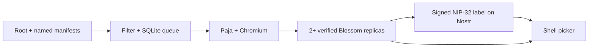

<div align="center">

# Napshot

**Missing screenshots for Nostr napplets, captured and labeled.**

[](package.json)
[](package.json)
[](https://github.com/napplet/napshot/stargazers)

[Quick start](#quick-start) · [Shell integration](#shell-integration) · [Configuration](#configuration) · [Operations](#operations)

</div>

Napshot watches root (`15129`) and named (`35129`) napplet manifests for missing screenshots.
It renders verified HTML in a fresh, signed-out Paja shell, mirrors the PNG to at least two
Blossom servers, and publishes a signed NIP-32 label referencing the exact manifest event.
Shells discover these previews through Nostr without changing the author’s manifest.

- **Author media first.** Usable screenshots in the manifest take precedence; trusted labels prevent duplicate work.
- **Resumes after restart.** SQLite preserves jobs, captures, upload receipts, and signed labels through failures.
- **Verifiable delivery.** Uploaded bytes are read back and checked before their servers appear in the label.
- **One process.** The worker also serves a small explainer page, public status, and a health endpoint.

Captures show the initial **signed-out, offline view**. Apps that need network data,
authentication, or interaction may show an empty or loading state. Snapshots (`5129`) are excluded.

## Quick start

Requires **Node.js 24+**, **pnpm 10.8**, and **Chromium with a working sandbox**.
The default browser path is `/usr/bin/chromium`; set `NAPSHOT_CHROMIUM` for another installation.
Napshot does not download a browser or disable its sandbox.

```sh
git clone https://github.com/napplet/napshot.git
cd napshot
pnpm install --frozen-lockfile
pnpm build
cp .env.example .env
chmod 600 .env
```

Edit `.env` and replace the example endpoints with your own configuration:

| Required setting | Supply |
| --- | --- |
| `NAPSHOT_SECRET_KEY` | A dedicated 64-character lowercase hex signing key |
| `NAPSHOT_RELAYS` | Comma-separated `wss://` relays to watch and publish to |
| `NAPSHOT_BLOSSOM_SERVERS` | At least two distinct HTTPS origins that accept uploads from your signer |

To generate a dedicated key locally:

```sh
node --input-type=module -e \
  'import {generateSecretKey} from "nostr-tools"; console.log(Buffer.from(generateSecretKey()).toString("hex"))'
```

Copy the key into `.env`, keep it private, and start the service:

```sh
node --env-file=.env dist/src/main.js
```

Open **<http://127.0.0.1:3080>** for the explainer and instance status. The startup log
and `/api/status` expose the public signer key that shell operators can verify and trust.

To preview the page without a signing key or a running worker:

```sh
node dist/src/main.js --site-only
```

## Shell integration

Install the coding-agent skill:

```sh
npx skills add napplet/napshot
```

Then ask your agent: “Use `$napshot-shell` to add trusted screenshot fallbacks to our napplet picker.”

The [skill](skills/napshot-shell/SKILL.md) covers discovery, signer trust, image verification,
and mirror fallback. Shells query kind `1985` using `#e` for the **exact manifest event ID**,
`#L: ["#screenshot"]`, and an explicitly trusted author list. Each label carries a
`screenshot` tag with the PNG hash, MIME type, dimensions, and size, plus its Blossom servers.

Prefer author-provided media, verify label signatures and downloaded bytes, and never
attach an image using only the stable `a` address. See the [wire contract](docs/protocol.md)
for complete tags and a query example. Shells read directly from Nostr and Blossom;
Napshot’s HTTP process does not need to stay online for already published previews.

## How it works



Each label is saved before publication. If a relay acknowledgement is lost, a retry
resends the same signed event. Upload failures retain the PNG and successful replicas;
publication waits until the configured minimum is met.

## Configuration

| Variable | Meaning / default |
| --- | --- |
| `NAPSHOT_SECRET_KEY` | Required lowercase hex private key; keep stable across restarts |
| `NAPSHOT_RELAYS` | Required comma-separated `wss://` relay URLs for watching and publishing |
| `NAPSHOT_BLOSSOM_SERVERS` | Required distinct HTTPS origins; at least two; also artifact fallbacks |
| `NAPSHOT_MIN_REPLICAS` | Minimum verified uploads before publication, default `2`, never below `2` |
| `NAPSHOT_TRUSTED_AUTHORS` | Additional comma-separated hex labeler public keys; own signer is always trusted |
| `NAPSHOT_DATA_DIR` | Local durable SQLite directory, default `./data` |
| `NAPSHOT_CHROMIUM` | Browser executable, default `/usr/bin/chromium` |
| `NAPSHOT_HOST`, `NAPSHOT_PORT` | Explainer/status bind, default `127.0.0.1:3080` |
| `NAPSHOT_POLL_MS` | Relay scan interval after each scan, default `30000` |
| `NAPSHOT_LOOKBACK_SECONDS` | First-run historical window, default `86400`; subsequent starts resume stored cursors |
| `NAPSHOT_WIDTH`, `NAPSHOT_HEIGHT` | Capture dimensions, default `1200` × `750` |
| `NAPSHOT_CAPTURE_DELAY_MS` | Settle time after loading, default `1500` |
| `NAPSHOT_CAPTURE_TIMEOUT_MS` | Overall browser capture limit, default `45000` |

Use servers that accept uploads from the configured signer. Napshot handles BUD-11
upload authorization; it does not purchase storage, negotiate payments, or perform
NIP-42 relay authentication. URLs are not credentials. HTTPS Blossom redirects are
rejected intentionally. At least two distinct origins are required, although different
origins do not prove independent infrastructure ownership.

## Operations

### Run persistently

Use the [systemd user-service template](deploy/napshot.service). Update `WorkingDirectory`
and `EnvironmentFile` to your clone location: the template uses `~/Develop/napplet-screenshotter`,
while the quick start creates `napshot/`. Set `ExecStart` to an absolute Node.js 24 binary
if your installation is outside the service PATH.

```sh
mkdir -p ~/.config/systemd/user
cp deploy/napshot.service ~/.config/systemd/user/napshot.service
systemctl --user daemon-reload
systemctl --user enable --now napshot.service
journalctl --user -u napshot.service -f
```

The user manager must remain running after logout for the service to continue. Configure
lingering under your host’s service policy if needed. Building the project does not install the service.

<details>
<summary><strong>Retries, recovery, and monitoring</strong></summary>

- Only signed, current single-artifact root/named manifests enter the queue. Snapshots
  (`5129`), legacy file-map manifests, malformed identities, and invalid signatures are ignored.
- A usable author `screenshot` hash takes precedence. Trusted kind-1985 labels bound to
  the exact event ID also suppress work. Untrusted labels cannot veto a capture. Metadata
  presence is the skip criterion; Napshot does not repair a declared but unavailable author image.
- Polling uses persisted per-relay cursors, a 60-second overlap, pagination and duplicate
  IDs. Checkpoints advance only after a successful complete scan. Relay timeout is an
  error, never an empty result. This cannot recover events a relay omits, timestamps
  backdated outside the overlap, or relays that silently cap results below the requested limit.
- New revisions supersede queued older revisions at the same address, using NIP-01
  timestamp and event-ID ordering. Already published labels remain attached to their original revisions.
- Jobs, captures, upload receipts and signed labels live in SQLite. Each output label
  is stored before publication. A lost acknowledgement or restart resends the same event
  ID. At least one configured relay must acknowledge publication; every configured relay
  is attempted. Retry delay grows from 5 seconds to 1 hour with no silent retry cutoff.
- Every configured Blossom server is attempted. Only replicas that pass descriptor and
  readback-hash checks are advertised. Below quorum, the PNG and successful replicas are
  retained for retry. A capture is discarded after completion; metadata remains for deduplication.
- All configured relays must answer the existing-label query before a new capture. An
  unavailable relay delays jobs instead of treating an incomplete check as proof of absence.
- The data directory allows one worker on one host. A stale PID lock is recovered after
  a crash. Do not share a data directory across containers/hosts with different PID spaces.
- SIGINT/SIGTERM finish the current bounded operation, then close HTTP and SQLite.
  Restart after a forced kill resumes durable jobs. Back up the database with SQLite’s
  backup tooling or stop the service before copying its data directory, including WAL files.

`/api/status` reports the signer, configured endpoints, queue counts and last successful
scan; it contains no secret key or manifest content. `/healthz` returns 200 only after a
recent complete scan, otherwise 503. Logs are JSON with job IDs and bounded failure
messages. A healthy scan does not imply every queued capture has succeeded; inspect the
failed count and retry logs. Put a reverse proxy in front if exposing the page publicly.

</details>

<details>
<summary><strong>Capture isolation and limits</strong></summary>

Napshot adapts the napplet CLI’s Paja/Playwright iframe capture flow; see
[third-party notices](THIRD_PARTY_NOTICES.md). A fresh anonymous browser
context has no account or signing keys. Network requests are restricted to the disposable
local preview; external requests, websocket connections, downloads and service workers
are blocked. Fetching signed artifacts uses bounded responses, pinned public DNS and
SHA-256 verification, preventing manifest hints from reaching local services.

A screenshot is a signed-out preview, not a correctness or safety endorsement. Applets
that require live network data, authentication, interaction or more time may show a
loading or empty state. Browser failures remain retryable jobs. Run an internet-facing
renderer as a dedicated unprivileged user/container with OS memory/CPU limits; Chromium's
sandbox and request interception are not a replacement for host isolation against browser exploits.

</details>

## Development

```sh
pnpm check
```

This runs structural lint, JavaScript syntax checks, strict TypeScript checks, a build,
and unit/integration tests with real Chromium. Tests use temporary keys and local relay
and Blossom fixtures, including restart and failure cases; they do not publish publicly.
Browser tests use `/usr/bin/chromium`, or `CHROMIUM_PATH` when set.

When contributing, keep changes focused and run `pnpm check` before opening a pull request.
For protocol changes, update the [wire contract](docs/protocol.md) and
[shell skill](skills/napshot-shell/SKILL.md) together.

### Project layout

```text
deploy/    # systemd user-service template
docs/      # screenshot annotation contract
public/    # explainer SPA
scripts/   # source structure and hygiene checks
skills/    # napshot-shell integration skill
src/       # watcher, durable queue, capture, uploads, and HTTP server
test/      # unit, browser, and wire-level integration tests
```

### Documentation

| Resource | Purpose |
| --- | --- |
| [Environment template](.env.example) | Required credentials and common settings |
| [Service template](deploy/napshot.service) | Persistent user-service setup |
| [Screenshot protocol](docs/protocol.md) | Label format, client query, and verification |
| [Shell integration skill](skills/napshot-shell/SKILL.md) | Agent instructions for adding previews to a shell |
| [Third-party notices](THIRD_PARTY_NOTICES.md) | Attribution for the reused capture implementation |
